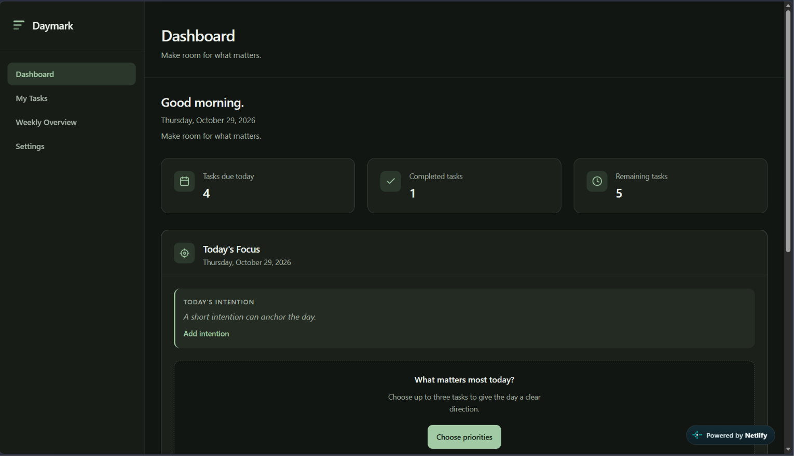
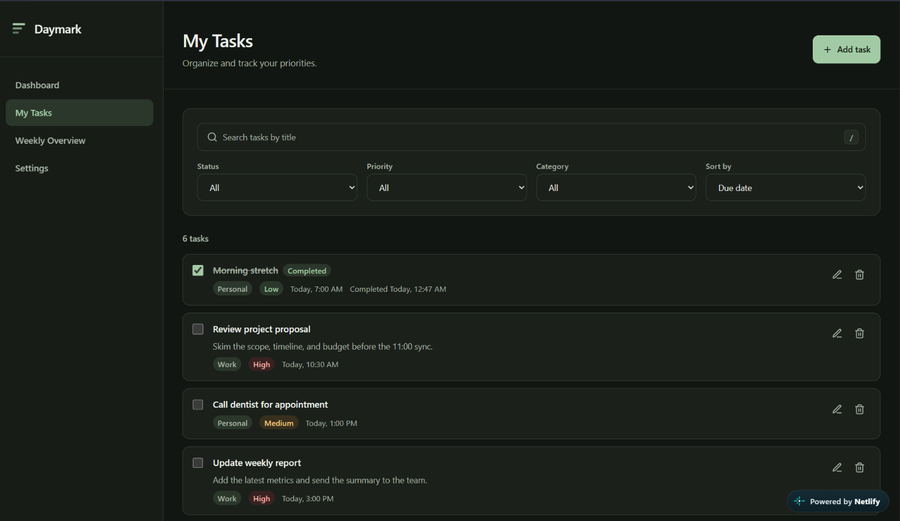
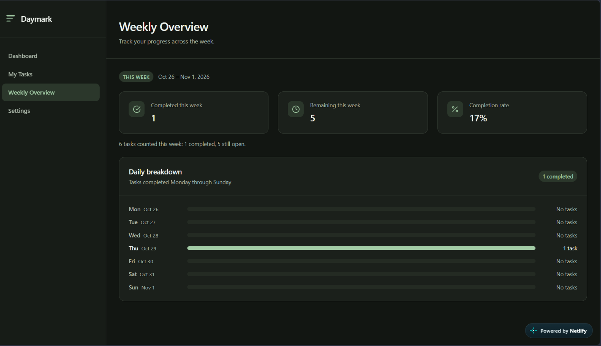
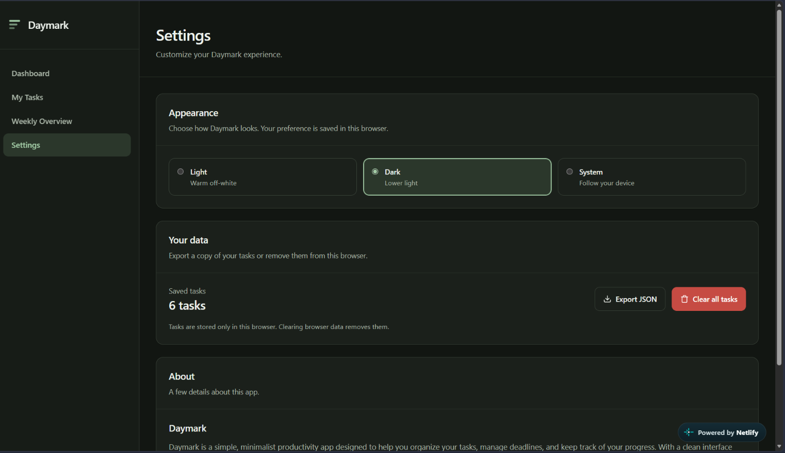

# Daymark

**A calm, local-first daily planner built around three priorities.**

[**Live Demo**](https://daymark-webapp.netlify.app) · [**GitHub Repository**](https://github.com/justinebaoy/daymark)

Daymark helps you cut through a long task list and decide what actually matters
today. It combines task management, a three-priority Daily Focus, and a weekly
progress view in a warm, distraction-free interface. There is no sign-up and no
server: tasks stay in the browser.

Built with vanilla HTML, CSS, and JavaScript, with no build step or production
dependencies.

## Overview

Most task apps make it easy to collect work and harder to choose where to start.
Daymark is built around a simple constraint: select at most three priorities for
the day, then work through them with a visible progress indicator.

The app has four pages:

- **Dashboard** for today's focus, task summary, deadlines, and weekly activity.
- **My Tasks** for creating, finding, and managing the full task list.
- **Weekly Overview** for a Monday-to-Sunday review of completed and remaining
  work.
- **Settings** for appearance, JSON export, and clearing saved tasks.

Daymark is designed to run entirely from static files. All assets are local, and
the application makes no external network requests.

## Features

### Task management

- Create, edit, complete, reopen, and delete tasks.
- Add an optional description, due date and time, priority, and category.
- Priorities: low, medium, and high.
- Categories: work, personal, study, and other.
- Search tasks by title.
- Filter by status, priority, and category.
- Sort by due date, priority, or date created.
- Confirm before permanently deleting a task.
- Press `/` on My Tasks to focus the search field.

### Daily Focus

- Choose up to **three tasks** as the day's priorities.
- Incomplete tasks are listed before completed ones in the picker.
- Add an optional intention of up to **160 characters**.
- Check off priorities directly from the dashboard.
- See live completion progress and a summary when every priority is complete.
- Edit the selection or remove a priority without deleting the underlying task.
- Deleted tasks are cleaned from the plan safely.
- A new local day starts with an empty focus; plans do not carry over.
- Saving a focus plan keeps today plus the previous 30 calendar days.

### Dashboard and weekly overview

- Summary cards for tasks due today, completed tasks, and remaining tasks.
- Today's Tasks includes active overdue tasks and tasks due today.
- Upcoming Deadlines shows active tasks due tomorrow or later.
- A weekly completion chart shows activity from Monday through Sunday.
- The Weekly Overview page reports completed tasks, remaining tasks, completion
  rate, and a per-day breakdown for the current week.

### Appearance and accessibility

- Light, dark, and system themes.
- System mode follows the operating system preference and updates when it
  changes.
- Responsive layout and mobile navigation.
- Skip link, semantic landmarks, labelled controls, and native dialogs.
- Keyboard navigation with managed dialog focus and focus return.
- Reduced-motion support for Daily Focus transitions.

The accessibility features above are implemented and partly covered by
automated checks; they are not a claim of full WCAG conformance.

### Local-first data

- Tasks, focus plans, and theme preference are stored in `localStorage`.
- No account, analytics, cookies, or application network calls.
- Export the task list as JSON from Settings.
- Clear all tasks from Settings after an explicit confirmation.

## Screenshots

### Dashboard



*The dashboard's task summary and Daily Focus, ready for the day's priorities.*

### My Tasks



*Search, filters, and task details in the My Tasks view.*

### Weekly Overview



*Weekly totals and a Monday-to-Sunday completion breakdown.*

### Settings



*Appearance and data controls in Settings.*

## Technology Stack

| Layer | Details |
| --- | --- |
| Markup | Semantic HTML5, native `<dialog>` elements, and templates |
| Styling | CSS3 with custom properties, responsive layouts, and light/dark themes |
| Behaviour | Vanilla JavaScript (ES6+), no framework |
| Persistence | Browser `localStorage` |
| Browser APIs | `<dialog>`, `matchMedia`, `Intl.DateTimeFormat`, `Blob` and object URLs |
| Hosting | Static deployment on Netlify |
| Testing | Node.js scripts driving headless Chromium over the Chrome DevTools Protocol |

There are no production dependencies, no package manager setup, and no build
output. JavaScript is split into small modules exposed as globals rather than
bundled.

## Project Structure

```text
Daymark/
├── index.html              # Dashboard and Daily Focus
├── tasks.html              # Task list, search, filters, add/edit/delete dialogs
├── overview.html           # Weekly statistics and daily breakdown
├── settings.html           # Theme, export, and clear-data controls
├── css/
│   ├── styles.css          # Tokens, layout, themes, and page styles
│   └── components.css      # Shared buttons, cards, forms, and dialogs
├── js/
│   ├── theme.js            # Early theme application and persistence
│   ├── storage.js          # localStorage access and recovery
│   ├── task-store.js       # Task data, validation, filtering, and sorting
│   ├── focus-store.js      # Daily Focus plans, limits, and retention
│   ├── ui.js               # Shared UI helpers and navigation
│   ├── dashboard.js        # Dashboard metrics, focus view, and charts
│   ├── tasks.js            # Task page interactions
│   ├── overview.js         # Weekly calculations and rendering
│   └── settings.js         # Appearance, export, and clear-data behaviour
├── tests/
│   ├── acceptance.js       # Headless browser acceptance suite
│   ├── static-audit.js     # Read-only structural and asset audit
│   └── README.md           # Test prerequisites and usage
├── .gitignore
└── README.md
```

The files in `tests/` are development tools and are not loaded by any
application page.

## Getting Started

### Live demo

Open [daymark-webapp.netlify.app](https://daymark-webapp.netlify.app).

The live deployment has been manually checked on a phone by the project owner.
It has not been tested across a comprehensive matrix of browsers, devices, or
assistive technologies.

### Run locally

Clone the repository:

```bash
git clone https://github.com/justinebaoy/daymark.git
cd daymark
```

Then open `index.html` directly in a browser. There is nothing to install or
build.

Serving the folder over local HTTP is optional. For example, with Python 3:

```bash
python -m http.server 8000
```

Then visit `http://localhost:8000/`.

`localStorage` is scoped to an origin, so data saved at `file://` will not appear
at `http://localhost:8000`, and vice versa. Use one approach consistently if you
want the same tasks to remain visible.

## Data Storage and Privacy

Daymark stores application data in the current browser under three keys:

| Key | Contents |
| --- | --- |
| `daymark.tasks.v1` | JSON array of task records with id, title, description, due date, priority, category, completion state, and timestamps. |
| `daymark.focus.v1` | JSON object containing a version and a map of local-date plans. Each plan holds up to three task IDs and an optional intention. |
| `daymark.theme.v1` | Appearance preference: `light`, `dark`, or `system`. |

On a first visit with no saved tasks, the app seeds six sample tasks. They are
ordinary tasks and can be edited or deleted; deleting all tasks does not recreate
them on reload.

If saved task or focus data cannot be parsed, Daymark preserves the original
value under `daymark.tasks.v1.unreadable` or `daymark.focus.v1.unreadable`
before replacing it.

Data is stored only in the browser and is scoped to the browser profile and
origin. It does not sync between browsers or devices. Clearing browser site data
removes the saved tasks, focus plans, and theme preference.

The application does not send task data to a server, include analytics, or make
external network requests. Data leaves the browser only when you choose to
export it.

### Export and reset

- **Export:** open **Settings → Your data → Export JSON**. The download is named
  `daymark-tasks-YYYY-MM-DD.json` and contains the task array only; focus plans
  and theme preference are excluded.
- **Clear:** open **Settings → Your data → Clear all tasks**. This permanently
  deletes saved tasks after confirmation and cannot be undone. Export a copy
  first if the data matters.
- The clear button removes tasks only. Theme preference and Daily Focus data use
  separate keys and remain until browser site data is cleared.
- There is no in-app import feature for exported JSON.

## Testing and Validation

The repository includes a portable static audit and a headless acceptance suite.
No framework or package installation is required.

**Prerequisites:** Node.js 22.4 or newer, plus Microsoft Edge or Google Chrome
for the browser suite.

From the project root:

```bash
node tests/static-audit.js
node tests/acceptance.js
```

| Command | What it checks |
| --- | --- |
| `node tests/static-audit.js` | Local references, document structure, IDs, ARIA targets, script order, storage keys, external URLs, and application network APIs. |
| `node tests/acceptance.js` | Daily Focus behaviour, task management regressions, export, themes, keyboard and mobile navigation, reduced motion, zero external requests, and a page/viewport/theme matrix. |

The acceptance suite contains **77 checks**:

- 17 Daily Focus functional tests.
- 10 regression tests.
- 1 reduced-motion accessibility check.
- 1 zero-external-request release check.
- 48 page × viewport × theme matrix checks.

The most recent local run passed **77/77** using Node.js 24.14.1 and headless
Microsoft Edge 156 on Windows. The matrix checks rendering, key content,
horizontal overflow, and console errors; it is not a pixel-diff visual baseline.
Browser automation covers Chromium-based browsers only.

Test artifacts are written to the operating system's temporary directory, not
into the repository. See [`tests/README.md`](tests/README.md) for environment
variables, skip options, and artifact locations.

## Known Limitations

- The live deployment has been manually checked on a phone by the project owner.
  Comprehensive cross-browser, cross-device, and screen-reader testing has not
  been performed.
- Automated browser tests run only in Chromium-based browsers. Firefox and Safari
  are not covered by the suite.
- Data is local to one browser profile and origin. There is no account system,
  cloud sync, or multi-device support.
- Clearing site data, private browsing, or browser storage limits can remove
  saved tasks.
- Exported JSON cannot be imported back through the interface.
- The hosted site does not include a service worker, so offline use of the hosted
  URL is not guaranteed. The app does work from local files without a network
  connection.
- Typography uses a system-font stack, so rendering varies by operating system.
- The accessibility checks are limited and do not replace a screen-reader or
  manual accessibility audit.

## Future Improvements

- Add genuine screenshots and a short demo recording to this README.
- Add JSON import so exported task data can be restored through the UI.
- Expand automated coverage to Firefox and WebKit, and add an automated
  accessibility audit.
- Add a service worker and web app manifest for installable offline use.
- Consider recurring tasks and optional reminders while keeping the app
  local-first.
